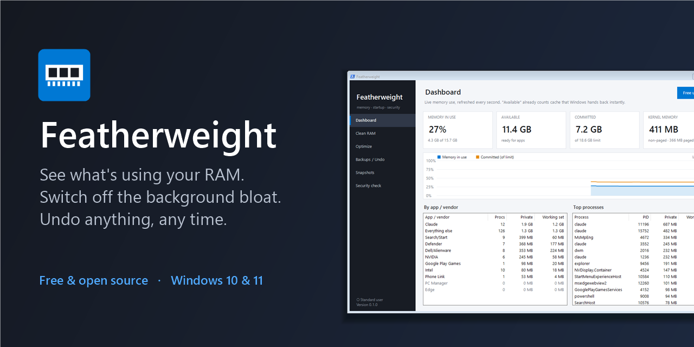
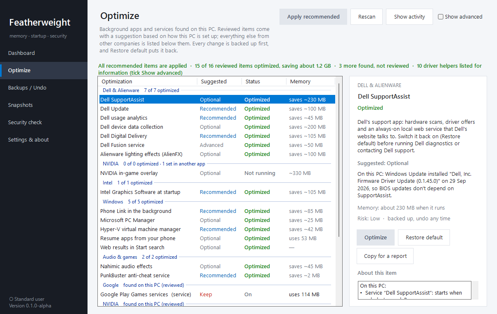
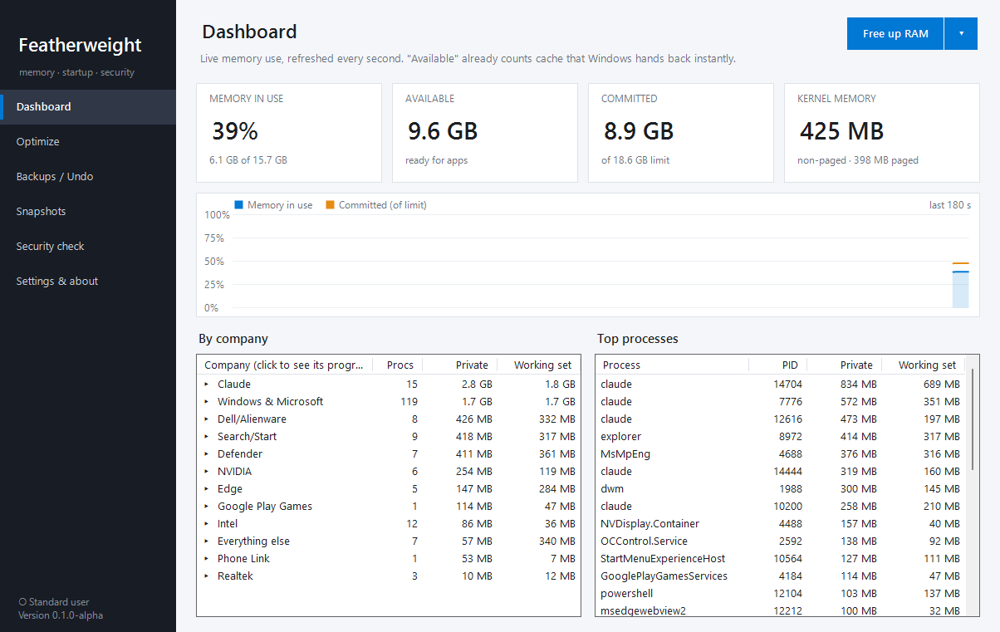

<div align="center">



# Featherweight

**See what's using your PC's memory. Switch off the background bloat you don't need. Undo anything, any time.**

[](LICENSE)
%20%7C%2011-0078D4)


[**Download**](../../releases/latest) · [Features](#features) · [Is it safe?](#is-it-safe) · [FAQ](#faq) · [Roadmap](docs/ROADMAP.md) · [Report a problem](../../issues/new/choose)

</div>

---

> [!NOTE]
> Featherweight is in **early development**. The first public release is being tested. Feedback is very welcome!

## Why Featherweight?

New PCs, especially gaming laptops, come with a lot of software that starts with Windows and quietly runs
in the background: support assistants, updaters, analytics, overlays, lighting services. Each one takes a
little memory, and together they can take a lot.

Featherweight shows you exactly what's running and **how much memory each thing uses right now**. It looks at
*your* PC before suggesting anything, so it never gives one-size-fits-all advice.

On the laptop it was developed on, the background apps it found were using about **1 GB of memory all the time**.
Results depend entirely on what's installed on your PC.

## Features



### 🎯 Optimize: suggestions made for *your* PC
- Finds the background apps and services that are **actually on your PC**, from any brand: services that start with Windows, startup apps, startup tasks and Store apps running in the background, grouped by the company that made them.
- Shows the **memory each one uses right now**.
- Items Featherweight has **reviewed** (Dell & Alienware, NVIDIA, Intel, Phone Link and more over time) get a suggestion: **Recommended**, **Optional**, or **Not advised here**, with an *"On this PC"* explanation. For example, it won't suggest turning off the Hyper-V service if you have virtual machines, or Dell Update if that's how your PC gets BIOS updates.
- Everything else it finds is listed as **Not reviewed**: you can still switch it off (backed up, undoable), after an extra warning.
- **Apply recommended** in one click (reviewed items only), or pick items yourself.
- Warns you if a Windows or app update **switches something back on**.

### ↩️ Everything is backed up and undoable
- The original settings are saved **before** every change.
- **Restore default** on any item, or undo a whole batch from the *Backups / Undo* page.
- Changes are gentle: services are set to *start when needed* instead of being deleted or disabled outright.

### 📊 Dashboard


Live memory, committed memory and kernel memory, a 3-minute history graph, memory use **grouped by app and vendor**, and the top processes.

### 🧹 Clean RAM in one click
Pushes idle memory out of every program, which is handy right before launching a game. Shows exactly how much was freed.
Honest note: Windows already manages memory well, so this is a short-term boost. The lasting win is fewer background apps.

### 🛡️ Security check (read-only)
Antivirus status (including third-party antivirus), unsigned programs, unusual root certificates, startup entries,
scheduled tasks, common hijack points and open network ports, all explained in plain language.

### 📸 Snapshots
Save a snapshot of memory use and compare two, e.g. before and after a change.

## Is it safe?

Featherweight changes Windows settings, so it's built around a few promises:

| | |
|---|---|
| ✅ **Shows before it changes** | Every item lists exactly what it changes ("What it changes"). |
| ✅ **Backs up first** | Original values are saved before anything is touched, plus a Windows System Restore point as a second safety net. |
| ✅ **Always undoable** | Restore default, or undo a whole batch, any time. |
| ✅ **Asks first** | Changing things needs administrator permission; viewing doesn't. |
| ✅ **No telemetry** | No tracking, no analytics, no accounts. The only connection is an optional daily update check (new versions and item descriptions, from GitHub), which you choose on first start. |
| ❌ **Never touches security** | It will never turn off Windows Update, Microsoft Defender or other security features. |
| ❌ **No scare tactics** | No fake "PC health score", no registry cleaner, no driver updater. |

It's open source: anyone can read exactly what it does. Security issues can be reported privately (see [SECURITY.md](SECURITY.md)).

## Download and run

1. Go to [**Releases**](../../releases/latest) and download `Featherweight.exe`.
2. Double-click it. No installer is needed; it uses .NET Framework 4.8, which is built into Windows 10 (22H2) and 11.
3. If Windows shows **"Windows protected your PC"**, click **More info → Run anyway**. This appears for new apps
   that don't have many downloads yet. Code signing is [on the roadmap](docs/ROADMAP.md).

Featherweight opens as a normal user, so you can look around safely. When you optimize, undo or clean RAM,
it asks to restart with administrator rights.

**Where your data lives:** backups and logs are kept in `%LocalAppData%\Featherweight`.
**Portable use** (e.g. on a USB stick): put an empty file named `portable` next to `Featherweight.exe`, and
everything stays in that folder.

### Removing Featherweight
1. Optional: open **Optimize**, select the items you want back, and click **Restore default** (or use *Backups / Undo*).
2. Delete `Featherweight.exe` and the folder `%LocalAppData%\Featherweight`.

Nothing else is left behind: no services, no startup entries.

## FAQ

<details>
<summary><b>Do I need a Dell or a gaming laptop?</b></summary>

No. Everything works on any Windows 10/11 PC. The Optimize page lists background software from any brand that's
on your PC. Detailed, reviewed advice currently covers Dell/Alienware, NVIDIA, Intel and Windows itself; other brands
(ASUS, MSI, Lenovo, HP, Razer…) show as *Not reviewed* until they're added, and you can
[ask for your PC's apps](../../issues/new/choose).
</details>

<details>
<summary><b>Isn't "RAM cleaning" snake oil?</b></summary>

Partly, and Featherweight is honest about it. Windows uses spare memory as a cache on purpose and hands it back
instantly when a program needs it. The cleaner does free memory right away (useful before launching something
heavy), but programs pull back what they need over time. The lasting improvement comes from the **Optimize**
page: apps that no longer start with Windows don't use memory at all.
</details>

<details>
<summary><b>Will it break anything?</b></summary>

It's designed not to: items that could affect a feature you use are marked *Optional* or *Not advised here*, with
an explanation. If something you rely on stops working, select it and click **Restore default**, then restart.
</details>

<details>
<summary><b>An update turned something back on. What now?</b></summary>

Driver and app updates sometimes re-enable their background services. Featherweight marks these as
**Changed back**; just optimize them again.
</details>

<details>
<summary><b>Why does it need administrator rights?</b></summary>

Changing how Windows services start, and freeing memory from other programs, are protected operations in
Windows. Viewing information doesn't need admin rights.
</details>

<details>
<summary><b>Does it send any data anywhere?</b></summary>

No. Featherweight has no telemetry. The only connection it makes is an optional update check: at most once a
day it asks GitHub for the latest version number and downloads the newest item descriptions (a small text file). You
choose this on first start and can change it any time in **Settings & about**. Nothing about you or your PC is sent,
and it never downloads or installs programs by itself.
</details>

## Supported systems

| | |
|---|---|
| **Windows** | Windows 11, Windows 10 22H2 (64-bit) |
| **Languages** | The app is in English, and works on any Windows display language |
| **Requirements** | .NET Framework 4.8 (built into the supported Windows versions) |

## Contributing

You don't need to code to help:
- 🐞 [Report a bug](../../issues/new/choose). Tip: **Settings & about → Export diagnostics** creates a report you can attach, with your user and PC name removed
- 💡 [Suggest an idea](../../issues/new/choose)
- 🖥️ [Ask for your PC's apps to be supported](../../issues/new/choose); usually a list of process names is all that's needed
- 📄 Add an optimization yourself: it's just JSON ([guide](docs/CATALOG.md))

See [CONTRIBUTING.md](CONTRIBUTING.md) for details.

### Building from source
Needs Visual Studio 2022 or the free *Build Tools for Visual Studio*:

```powershell
powershell -ExecutionPolicy Bypass -File build.ps1
```

The exe appears in `artifacts\`.

## How it's built

Featherweight is made by [@workingwithbunnies](https://github.com/workingwithbunnies) together with
[Claude](https://claude.com/claude-code), Anthropic's AI coding assistant, which writes and tests much of the code.
Commits it helped with are marked with Claude as co-author, so you can see that throughout the history.
Every change is still reviewed, tested on real PCs, and released by a human.

## License

[MIT](LICENSE): free to use, change and share.

Featherweight is provided as-is, without warranty. It changes Windows settings, so read what each change does
before applying it, and keep your own backups of important data.
