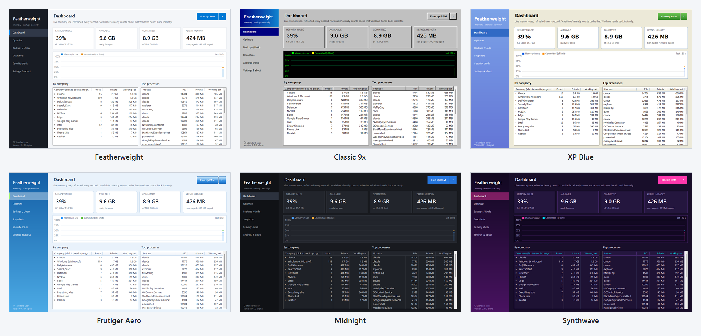

<div align="center">


# Featherweight

**A free, open-source RAM cleaner and startup optimizer for Windows 10 and 11.**<br>
See what's using your PC's memory, switch off the background bloat you don't need, and undo anything, any time.

[](LICENSE)
%20%7C%2011-0078D4)
[](../../releases)
-orange)


[**Download**](../../releases) · [Features](#features) · [Is it safe?](#is-it-safe) · [Help test](#help-test-the-alpha) · [FAQ](#faq) · [Report a problem](../../issues/new/choose)

</div>

---

> [!NOTE]
> This is an **alpha**: the first public test version. It has been used and tested on two laptops (a Dell and an HP)
> and hasn't met many other PCs yet. Everything it changes is backed up and undoable, but expect rough edges, and
> please [tell us how it went on your PC](#help-test-the-alpha).

## Why Featherweight?

New PCs, especially gaming laptops, come with a lot of software that starts with Windows and quietly runs
in the background: support assistants, updaters, analytics, overlays, lighting services. Each one takes a
little memory, and together they can take a lot.

Featherweight shows you exactly what's running and **how much memory each thing uses right now**. It looks at
*your* PC before suggesting anything, so it never gives one-size-fits-all advice.

On the laptop it was developed on, the background apps it found were using about **1 GB of memory all the time**.
Results depend entirely on what's installed on your PC.

People use it to **free up RAM before gaming**, **stop bloatware and startup apps** from running in the background,
**see which apps use the most memory**, and **check their PC's security settings**, all in one small app with no
installer, no ads and no account.

## Features


### 🎯 Optimize: suggestions made for *your* PC
- Finds the background apps and services that are **actually on your PC**, from any brand: services that start with Windows, startup apps, startup tasks and Store apps running in the background, grouped by the company that made them.
- Shows the **memory each one uses right now**.
- Items Featherweight has **reviewed** (Dell & Alienware, NVIDIA, Intel, Phone Link and more over time) get a suggestion: **Recommended**, **Optional**, or **Not advised here**, with an *"On this PC"* explanation. For example, it won't suggest turning off the Hyper-V service if you have virtual machines, or Dell Update if that's how your PC gets BIOS updates.
- Everything else it finds is listed as **Not reviewed**: you can still switch it off (backed up, undoable), after an extra warning.
- **Apply recommended** in one click (reviewed items only), or pick items yourself.
- Warns you if a Windows or app update **switches something back on**.

### ↩️ Everything is backed up and undoable
- The original settings are saved **before** every change.
- **Restore default** on any item, or undo a whole batch from the *Backups / Undo* page.
- Changes are gentle: services are set to *start when needed* instead of being deleted or disabled outright.

### 📊 Dashboard


Live memory, committed memory and kernel memory, a 3-minute history graph, memory use **grouped by company** (click one to see
its programs), and the top processes.

### 🧹 Free up RAM in one click
On the Dashboard: pushes idle memory out of every program, which is handy right before launching a game, and shows
exactly how much was freed. The small arrow next to the button offers a deep clean that also empties the file cache.
Honest note: Windows already manages memory well, so this is a short-term boost. The lasting win is fewer background apps.

### 🛡️ Security check
A plain-language look at how the PC is protected: antivirus (including third-party), when Defender last scanned (with a
"quick scan now" button), firewall, SmartScreen, User Account Control, Secure Boot, TPM, drive encryption, Core
isolation, Windows Update, Remote Desktop, old SMB1 file sharing, automatic sign-in, browser extensions, unsigned
programs, unusual root certificates, startup entries, scheduled tasks, services, hijack points and open network ports.
It only reads. A few findings offer a backed-up fix (remove a certificate, switch off a startup entry or task running
from a user folder); for Windows' own security settings it opens the right Windows page instead of changing them itself.
It isn't an antivirus: Microsoft Defender (or your own antivirus) does the scanning.

### 📸 Snapshots
Save a snapshot of memory use and compare two, e.g. before and after a change.

### 🎨 Six themes


Pick a look in **Settings & about → Theme**: *Featherweight* (standard), *Classic 9x* (inspired by Windows 95/98, with a
green-on-black graph), *XP Blue* (inspired by Windows XP), *Frutiger Aero* (inspired by Windows 7), *Midnight* (dark
mode) and *Synthwave* (neon). It switches straight away and is remembered.

## Is it safe?

Featherweight changes Windows settings, so it's built around a few promises:

| | |
|---|---|
| ✅ **Shows before it changes** | Every item lists exactly what it changes ("What it changes"). |
| ✅ **Backs up first** | Original values are saved before anything is touched, plus a Windows System Restore point as a second safety net. |
| ✅ **Always undoable** | Restore default, or undo a whole batch, any time. |
| ✅ **Asks first** | Changing things needs administrator permission; viewing doesn't. |
| ✅ **No telemetry** | No tracking, no analytics, no accounts. The only connection is an optional daily update check (new versions and item descriptions, from GitHub), which you choose on first start. |
| ❌ **Never touches security** | It will never turn off Windows Update, Microsoft Defender or other security features. |
| ❌ **No scare tactics** | No fake "PC health score", no registry cleaner, no driver updater. |

It's open source: anyone can read exactly what it does. Security issues can be reported privately (see [SECURITY.md](SECURITY.md)).
How releases are built and signed: [**Code signing policy**](docs/CODE_SIGNING.md).

## Download and run

> [!IMPORTANT]
> **The only official download is this repository's [Releases page](../../releases)** (github.com/workingwithbunnies/Featherweight).
> Featherweight is free. If you were offered it on another website, in a zip from someone else, or for money, don't
> run that file, and please [let us know](SECURITY.md#fake-copies).

1. Go to [**Releases**](../../releases) and download `Featherweight.exe` from the newest version.
2. Double-click it. No installer is needed; it uses .NET Framework 4.8, which is built into Windows 10 (22H2) and 11.
3. If Windows shows **"Windows protected your PC"**, click **More info → Run anyway**. This appears for new apps
   that don't have many downloads yet. Featherweight is applying for code signing ([Code signing policy](docs/CODE_SIGNING.md)).

Featherweight opens as a normal user, so you can look around safely. When you optimize, undo or clean RAM,
it asks to restart with administrator rights.

**Check that your download is genuine (optional):**
- **Checksum:** each release lists the SHA-256 checksum of `Featherweight.exe`. In PowerShell, run
  `Get-FileHash .\Featherweight.exe` in the download folder and compare it with the one on the release page.
- **Proof of origin** (from 0.1.0-alpha.3): every release exe comes with a record, signed by GitHub, that it was built
  by this repository's own build system from its public source code. With the [GitHub CLI](https://cli.github.com)
  installed, run `gh attestation verify Featherweight.exe -R workingwithbunnies/Featherweight`. It says
  *Verification succeeded* for a genuine file. A modified or look-alike file fails, even if someone publishes their own
  checksum next to it. You can also see the records on the [Attestations page](../../attestations).

**Where your data lives:** backups and logs are kept in `%LocalAppData%\Featherweight`.
**Portable use** (e.g. on a USB stick): put an empty file named `portable` next to `Featherweight.exe`, and
everything stays in that folder.

### Removing Featherweight
1. Optional: open **Optimize**, select the items you want back, and click **Restore default** (or use *Backups / Undo*).
2. Delete `Featherweight.exe` and the folder `%LocalAppData%\Featherweight`.

Nothing else is left behind: no services, no startup entries.

## Help test the alpha

Thank you for trying it! The most useful thing you can do is use it on **your** PC and tell us what happened,
especially if it isn't a Dell or HP laptop, runs Windows 10, uses another display language, or uses display scaling
above 100 %.

1. Look around first (no admin needed): **Dashboard**, **Optimize** (does it find your PC's background apps, and are
   the descriptions right?), **Security check**, and a few **themes**.
2. If you like, try changing something: optimize one or two items, then **Restore default** to put them back.
3. Tell us how it went with the [**Test report**](../../issues/new?template=test_report.yml) form. It takes two
   minutes. Screenshots help a lot, and so does **Settings & about → Export diagnostics** (you choose what's in it;
   your user and PC name are removed).

Not on GitHub? Send the maintainer your notes and screenshots directly; that works too.

## FAQ

<details>
<summary><b>Do I need a Dell or a gaming laptop?</b></summary>

No. Everything works on any Windows 10/11 PC. The Optimize page lists background software from any brand that's
on your PC. Reviewed advice currently covers Dell/Alienware, HP/OMEN, NVIDIA, AMD, Intel, Realtek and Windows itself,
plus apps like Steam, the EA app and Google Play Games; anything else shows as *Not reviewed* until it's added, and you
can [ask for your PC's apps](../../issues/new/choose).
</details>

<details>
<summary><b>Isn't "RAM cleaning" snake oil?</b></summary>

Partly, and Featherweight is honest about it. Windows uses spare memory as a cache on purpose and hands it back
instantly when a program needs it. The cleaner does free memory right away (useful before launching something
heavy), but programs pull back what they need over time. The lasting improvement comes from the **Optimize**
page: apps that no longer start with Windows don't use memory at all.
</details>

<details>
<summary><b>Why does Windows (or my antivirus) warn about it?</b></summary>

Featherweight is new and not yet code-signed, so Windows SmartScreen shows *Windows protected your PC* until enough
people have downloaded it (click **More info → Run anyway**). Some antivirus programs are also suspicious of any app
that changes services and startup settings. The full source code is here for anyone to read, every release is built by
GitHub from that code, and you can [check the checksum and proof of origin](#download-and-run). Featherweight is
[applying for free code signing](docs/CODE_SIGNING.md) for open-source projects.
</details>

<details>
<summary><b>Will it break anything?</b></summary>

It's designed not to: items that could affect a feature you use are marked *Optional* or *Not advised here*, with
an explanation. If something you rely on stops working, select it and click **Restore default**, then restart.
</details>

<details>
<summary><b>An update turned something back on. What now?</b></summary>

Driver and app updates sometimes re-enable their background services. Featherweight marks these as
**Changed back**; just optimize them again.
</details>

<details>
<summary><b>Why does it need administrator rights?</b></summary>

Changing how Windows services start, and freeing memory from other programs, are protected operations in
Windows. Viewing information doesn't need admin rights.
</details>

<details>
<summary><b>Snipping Tool (or another shortcut) doesn't work while Featherweight is open</b></summary>

When Featherweight runs **as administrator** and its window is the active one, Windows doesn't let normal programs
react to keys pressed in it. That's a Windows security rule, and it affects every program running as administrator
(Task Manager too). Click another window or the desktop first, or close Featherweight when you've finished making
changes. Featherweight opened normally (not as administrator) doesn't have this effect.
</details>

<details>
<summary><b>Does it send any data anywhere?</b></summary>

No. Featherweight has no telemetry. The only connection it makes is an optional update check: at most once a
day it asks GitHub for the latest version number and downloads the newest item descriptions (a small text file). You
choose this on first start and can change it any time in **Settings & about**. Nothing about you or your PC is sent,
and it never downloads or installs programs by itself.
</details>

## Supported systems

| | |
|---|---|
| **Windows** | Windows 11, Windows 10 22H2 (64-bit) |
| **Languages** | The app is in English, and works on any Windows display language |
| **Requirements** | .NET Framework 4.8 (built into the supported Windows versions) |

## Contributing

You don't need to code to help:
- 🐞 [Report a bug](../../issues/new/choose). Tip: **Settings & about → Export diagnostics** creates a report you can attach; you choose what's in it, and your user and PC name are removed
- 💡 [Suggest an idea](../../issues/new/choose)
- 🖥️ [Help describe an app](../../issues/new/choose): on the Optimize page, select it and click **Copy for a report** (only that app's details)
- 📄 Write descriptions yourself: it's just JSON ([guide](docs/KNOWLEDGE.md))

GitHub issues are public, so read what you share first. More in [CONTRIBUTING.md](CONTRIBUTING.md#privacy-when-you-share).

See [CONTRIBUTING.md](CONTRIBUTING.md) for details.

### Building from source
Needs Visual Studio 2022 or the free *Build Tools for Visual Studio*:

```powershell
powershell -ExecutionPolicy Bypass -File build.ps1
```

The exe appears in `artifacts\`.

## How it's built

Featherweight is made by [@workingwithbunnies](https://github.com/workingwithbunnies) together with
[Claude](https://claude.com/claude-code), Anthropic's AI coding assistant, which writes and tests much of the code.
Commits it helped with are marked with Claude as co-author, so you can see that throughout the history.
Every change is still reviewed, tested on real PCs, and released by a human.

## License

[MIT](LICENSE): free to use, change and share.

Featherweight is provided as-is, without warranty. It changes Windows settings, so read what each change does
before applying it, and keep your own backups of important data.
